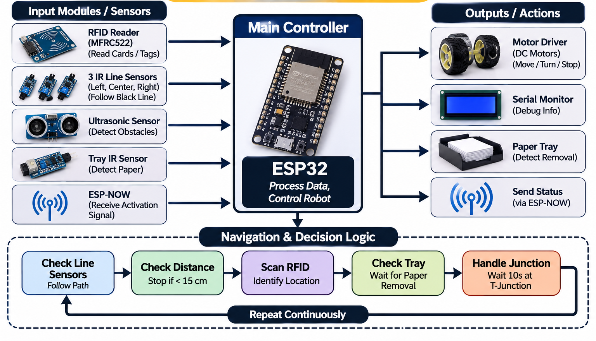
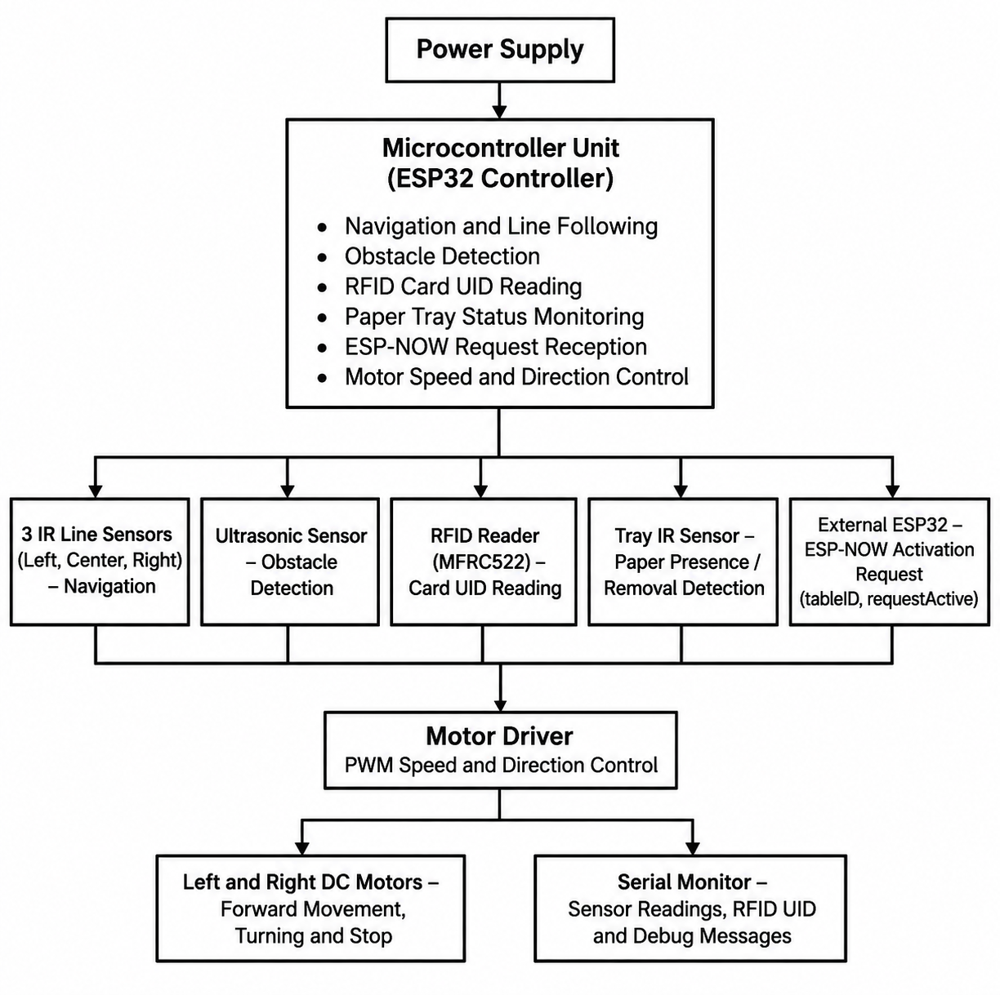
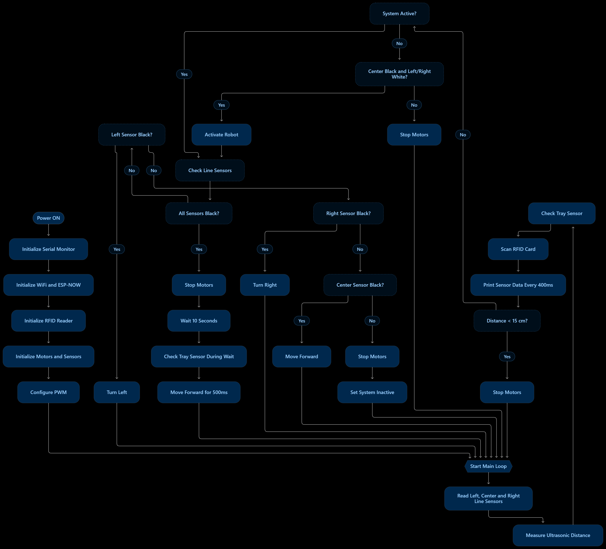

# 🤖 ExamBot – Autonomous Exam Assistant Robot

<p align="center">
  
</p>

<p align="center">
  <strong>Attend • Distribute • Assist</strong>
</p>

ExamBot is an autonomous exam-assistant robot project designed to support examination-room activities. The intended system helps distribute examination papers, identify students, monitor paper collection, and support attendance-related tasks.

This repository contains the current ESP32 robot firmware, individual component test sketches, and project diagrams.

> **🚧 Implementation status:** The main firmware currently implements line-following navigation, ultrasonic obstacle stopping, RFID UID scanning, paper-tray state detection, and ESP-NOW activation reception. The complete planned examination workflow is not yet implemented. In particular, the current code does not record attendance, map RFID tags to students/desks, wait specifically for paper removal before proceeding, implement scheduled exam start, process Bluetooth late-student requests, or automatically return to its starting point.

---

## 📐 Project diagrams

### System Overview



### System Block Diagram

This diagram represents the hardware and functions present in the current firmware.



### System Workflow



---

## ⚙️ Current implemented features

- **ESP32 control:** Reads sensors, runs the navigation logic, and controls the motors.
- **Black-line following:** Uses three IR line sensors (left, center, and right) to adjust the robot's movement.
- **Obstacle detection:** Uses an ultrasonic sensor and stops the motors when the measured distance is below 15 cm.
- **RFID scanning:** Uses an MFRC522 reader to read and print the detected card UID to the Serial Monitor. The current sketch does not save attendance records or associate a UID with a student.
- **Paper-tray monitoring:** Uses an IR sensor to detect changes interpreted as paper being placed on or removed from the tray.
- **Junction handling:** When all three line sensors detect black, the robot stops, checks the tray sensor during a 10-second wait, then drives forward for 500 ms.
- **ESP-NOW reception:** Receives a message containing `tableID` and `requestActive`. When `requestActive` is true, it sets the robot's `systemActive` flag and prints the target table ID. The current navigation logic does not yet navigate to that specific table.
- **Serial debugging:** Prints sensor readings and distance/tray information approximately every 400 ms, as well as RFID and tray events.

---

## 🔌 Hardware used in the current firmware

| Component | Purpose | ESP32 connection |
|---|---|---|
| ESP32 development board | Main controller | — |
| 3 IR line sensors | Black-line detection | GPIO 34, 35, 36 |
| Ultrasonic sensor | Obstacle distance measurement | TRIG: GPIO 13, ECHO: GPIO 12 |
| MFRC522 RFID reader | RFID card/tag UID reading | SS: GPIO 5, RST: GPIO 22; SPI pins use the board's SPI configuration |
| Tray IR sensor | Paper-tray state detection | GPIO 39 |
| Motor driver | Controls the two DC motors | ENA: GPIO 14, IN1: GPIO 25, IN2: GPIO 26, ENB: GPIO 27, IN3: GPIO 33, IN4: GPIO 32 |
| External ESP32 | Sends activation requests | ESP-NOW wireless communication |

Check the wiring and voltage requirements of your exact modules and motor driver before powering the circuit. The firmware pin definitions are the source of truth for the current sketch.

---

## 📁 Repository contents

```text
Robot-ESP32-Code/Robotics-ESP32/Robotics-ESP32.ino
```
The main ESP32 firmware.

```text
Component-Test-Codes/
```
Individual sketches for testing the sensors, motors, RFID reader, push button, and other modules before integrating them into the main program.

```text
Images/
```
Project logo, system diagrams, and workflow diagram used in the documentation.

---

## 📚 Software and libraries

- Arduino IDE
- ESP32 Arduino Core
- `Arduino.h`
- `SPI.h`
- `MFRC522` library
- `esp_now.h`
- `WiFi.h`

The ESP32 Arduino Core provides the ESP32-specific Wi-Fi, ESP-NOW, GPIO, ADC, and LEDC PWM functionality. Install a compatible ESP32 board package and the MFRC522 library through the Arduino IDE before compiling.

---

## 🚀 Setup and upload

1. Install the Arduino IDE.
2. Install the ESP32 board package using Boards Manager.
3. Install the **MFRC522** library using Library Manager.
4. Connect the ESP32 development board to your computer using USB.
5. Open `Robot-ESP32-Code/Robotics-ESP32/Robotics-ESP32.ino`.
6. Select the correct ESP32 board and COM/serial port.
7. Check that the physical wiring matches the pin definitions in the sketch.
8. Upload the sketch to the ESP32.
9. Open Serial Monitor at **115200 baud** to view sensor readings and debug messages.
10. Test each component safely, preferably using the relevant sketch in `Component-Test-Codes/` before running the integrated robot.

### 📡 Important ESP-NOW note

The robot firmware is configured in Wi-Fi station mode and registers an ESP-NOW receive callback. The transmitting ESP32 must use a compatible message structure and ESP-NOW configuration. The current message structure is:

```cpp
typedef struct struct_message {
    int tableID;
    bool requestActive;
} struct_message;
```

The receiver currently checks `requestActive` and activates the system. It does not use `tableID` for desk-specific route selection yet.

---

## 🧭 Current navigation behavior

The main loop repeatedly reads the three line sensors and ultrasonic distance, checks the tray sensor, and scans for RFID cards.

| Sensor condition | Current action |
|---|---|
| Center sensor detects black only | Drive forward |
| Left sensor detects black | Adjust by driving the right motor |
| Right sensor detects black | Adjust by driving the left motor |
| All three line sensors detect black | Stop, wait 10 seconds while checking the tray, then drive forward for 500 ms |
| No line sensor detects black | Stop and set the system inactive |
| Obstacle distance is below 15 cm | Stop the motors |

The exact response depends on the threshold values and sensor orientation. Calibrate the thresholds for the actual floor, line material, lighting, and sensor modules.

---

## 📋 Planned system features

The broader project concept includes the following features, which should be treated as planned work unless implemented in a later firmware version:

- Start the robot 10 minutes before the scheduled examination.
- Follow a predefined route and stop at desks associated with student IDs.
- Allow students to scan their IDs and record attendance.
- Wait for a student to take the paper, then continue to the next desk.
- Wait for a defined period when a student is absent, then continue.
- Return to the initial position after completing the route.
- Accept late-student requests from desk buttons and navigate to the requested desk.

---

## 🛡️ Safety and testing

- Test with the wheels raised before the first floor test.
- Keep hands, cables, and objects clear of the wheels and motor mechanisms.
- Verify motor-driver and battery ratings before connecting motors.
- Test the ultrasonic stop behavior with a safe obstacle and verify the stopping distance.
- Confirm the IR sensor thresholds under the actual operating conditions.
- Do not rely on RFID UID printing as attendance recording; attendance storage and student verification must be implemented separately.

---

## 🔮 Future improvements

- Add student-ID validation and attendance storage.
- Implement desk identification and route/state management.
- Add paper-removal confirmation as a condition for proceeding.
- Implement the scheduled start and absent-student timeout logic.
- Add Bluetooth or another suitable desk-request communication method if required by the final design.
- Implement route completion and return-to-base behavior.
- Add robust communication validation, timeout handling, and recovery behavior.

---

## 📌 License

This project is developed for academic and demonstration purposes.

---

<div align="right">
  
</div>
